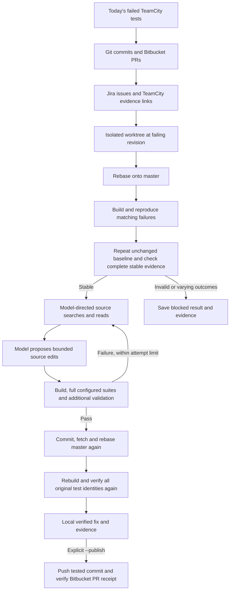

# Auto Fix

A small Windows-first workflow that investigates today's failing TeamCity C++ tests, gathers Git, Bitbucket Data Center and Jira context, asks your own Qwen endpoint for a focused fix, and opens a Bitbucket pull request after local verification.

The framework is **LangGraph**. The research compared it with CrewAI, Microsoft Agent Framework and PydanticAI before implementation. LangGraph fits the explicit collect → repair → build → test loop, has a substantial open-source community, and runs without a hosted agent service. Read the dated comparison and primary sources in [docs/research.md](docs/research.md).

GitHub hosts this tool. Your C++ source, generated branches and fix PRs stay in your existing on-premises Bitbucket repository. The model requests go to the configured OpenAI-compatible endpoint.



The API, Git and compiler nodes are ordinary Python functions; the model performs diagnosis, requests bounded source evidence, and proposes exact text edits. You can extend the workflow by adding a named node and an edge in the graph. Read [the complete workflow and extension guide](docs/workflow.md) for each gate and its evidence. There is one worker and one model endpoint, keeping resource use and execution order easy to follow.

## Try the complete local demo

Prerequisites: Python 3.11 or 3.12, [uv](https://docs.astral.sh/uv/getting-started/installation/), Git, CMake 3.26+, and a C++ compiler. On Windows, install Visual Studio 2022 Build Tools with **Desktop development with C++**, then use a Developer PowerShell terminal. Existing CMake installations must support CTest's `--output-junit` option.

```powershell
git clone https://github.com/Nielk74/auto-fix.git
Set-Location auto-fix
uv sync --locked --extra dev --python 3.12
uv run --no-sync auto-fix demo --directory .auto-fix/demo
```

The demo uses in-process fake HTTP responses and a deterministic fake model, creates a real disposable Git repository, compiles a small broken C++ program, reproduces its test failure, applies a fix, rebases and retests. It exercises the publication path against the fake Bitbucket adapter. It needs no enterprise credentials. The JSON result identifies the local evidence directory.

```powershell
uv run --no-sync auto-fix graph
uv run --no-sync pytest
```

CI runs the checks and native C++ demo on both Windows and Linux with Python 3.11 and 3.12. The small demo uses synthetic services and source code; the larger evaluation uses synthetic services with real public Abseil source. A passing demo establishes the sample workflow; your real server versions, model and C++ solution still need configuration and a local trial.

## Evaluate against a substantial C++ repository

The expanded evaluation covers **45 distinct synthetic regressions in Abseil and fmt**, split by behavior family into 24 development cases and 21 held-out cases. It completed **468 C++ workflow trials with 1,401 actual Luna calls**, plus 41 operational fault trials with 73 calls. Cases include multi-location and multi-file changes, indirect Git context, and faults across Git, model delivery and PR recovery.

The frozen selected workflow passed its configured native suites in **63/63 holdout runs**. Independent review found no confirmed functional defect in **54/63**: the first selected round scored **19/21 distinct cases**, versus **3/21** for the baseline. Two further rounds repeat those same 21 cases. Nine published patches retained contract defects despite green tests: six public output failures and three internal helper failures. The fresh operational run produced all 13 expected behaviors, including correct blocks and publication reconciliation. See the [concise results](docs/results.md), [complete method](docs/expanded-evaluation.md), [frozen dataset](evaluation/expanded/dataset-index.json), and [raw evidence](docs/evidence-artifacts.md). These synthetic public-project results do not estimate production accuracy or Qwen quality. The original four cases below remain a smoke benchmark.

The evaluation uses pinned **Abseil C++**, with 840 source/header files and 265,865 lines, and realistic synthetic TeamCity, Bitbucket and Jira data. Four independently injected source defects are checked by unchanged upstream tests. Git, native builds, rebases, and local branch publication run for real; enterprise services are mocked.

Live GPT-6 Luna evaluation on macOS improved from **2 of 4 cases repaired to 4 of 4** after source-context changes. The final round and a fresh confirmation each repaired all four cases with one model call per case and passed 188 unchanged upstream tests per round. The initial unsuccessful retrieval revision is retained in the [results and evidence](docs/evaluation.md#verified-live-results). These four synthetic regressions are a smoke benchmark, not a general repair-rate estimate.

Run an actual GPT-6 Luna evaluation through an authenticated Codex CLI:

```powershell
uv run --no-sync auto-fix evaluate --directory .auto-fix/evaluation/luna --profile focused --backend codex --model gpt-6-luna
```

Or rerun saved Luna responses with fresh native builds and no live inference:

```powershell
uv run --no-sync auto-fix evaluate --directory .auto-fix/evaluation/replay --backend replay --recordings evaluation/recordings/accepted
```

Use a new output directory for each run. Windows uses Visual Studio C++ build tools; Linux/macOS also require Ninja. To evaluate your Qwen server while keeping enterprise systems mocked, use `--backend endpoint --config config.local.yaml`.

[The evaluation guide](docs/evaluation.md) covers case selection, comparing workflow changes, model recordings, evidence, and limitations. [Fixture provenance](evaluation/README.md) records exact upstream revisions and the four scenarios.

## Connect your systems

Start from [examples/config.windows.yaml](examples/config.windows.yaml) for CMake/CTest or [examples/config.msbuild.yaml](examples/config.msbuild.yaml) for a Visual Studio solution and GoogleTest executable.

```powershell
Copy-Item examples/config.windows.yaml config.local.yaml
Copy-Item .env.example .env
# Edit config.local.yaml and .env with your local values.
uv run --no-sync auto-fix scan --config config.local.yaml
uv run --no-sync auto-fix run --config config.local.yaml
```

Set the actual TeamCity build configuration IDs, Bitbucket project/repository, C++ clone path, model URL and served model ID. `llm.url` is the API base, normally ending in `/v1`; the client calls Chat Completions. All service tokens come from the environment variable names in the YAML. The CLI loads a local `.env`; shell environment values take precedence. `.env`, `config.local.yaml`, local state and worktrees are ignored by Git.

Use the server root URL for TeamCity, Bitbucket and Jira, including any deployment context such as `/bitbucket` or `/jira`. Set `ca_bundle` to an absolute PEM path when your on-premises services use an internal CA. Git uses its own trust and authentication settings: configure Git Credential Manager or SSH for the worker account.

The workflow needs TeamCity read access, Bitbucket repository/PR read access, Jira issue read access when Jira is enabled, and access to your custom model. Publishing additionally needs Git push access and Bitbucket PR creation access. No credentials belong in repository URLs or committed YAML.

Build commands are argument arrays executed in the isolated worktree. The CMake example uses `--clean-first` and the MSBuild example uses `/t:Rebuild /nr:false` so verification rebuilds the edited sources instead of accepting stale incremental binaries. Configure the complete suite you want verified, not only the previously failing test. The test command must write a fresh XML report at `{junit}`. The Windows examples set `baseline_repetitions: 2`: two unchanged-source native runs must reproduce the failures with identical passed, failed and skipped test identities before inference. Invalid, incomplete or varying baseline evidence stops the run. The compatibility default is one repetition.

The validator requires the original failing test identities to appear as passing after repair. XML identity is `classname.name` when `classname` is nonempty and differs from `name`; otherwise it is `name`. This keeps GoogleTest fixtures distinct, such as `Arithmetic.AddsIntegers`, while CTest's identical class/name fields remain a single name. Duplicate identities are rejected. Use `build.test_name_map` when TeamCity uses a different label; confirm both sides against your runner's XML. An empty, missing or unrelated report cannot authorize publication.

`repository.allowed_paths` controls which source files the model can edit; keep test, build and workflow files outside that list. `context_paths` controls the source files available for diagnosis. The default `context_strategy: focused` retrieves bounded excerpts around failure locations, symbols, and local includes, including relevant code deep inside large files. `legacy` retains the original file-prefix strategy for comparison. Context, model output, edit size, retries and command duration are bounded. Change `max_attempts` to adjust the default two repair attempts.

The example configurations enable the policy selected on Luna development cases: `assertion-v4`, complete bounded C++ definition reads, six inspections shared across up to four repairs, at most two inspections per attempt, and a 160,000-character input budget. They also require two unchanged baselines. Qwen quality and your endpoint's context capacity are unmeasured; adjust `llm.context_chars` to the deployed capacity and evaluate that configuration. Provider-specific reasoning fields remain in `llm.extra_body` for your server's supported options.

“Today” uses the configured IANA timezone, defaulting to `Europe/Paris`. To investigate a specific date:

```powershell
uv run --no-sync auto-fix scan --config config.local.yaml --date 2026-10-20
uv run --no-sync auto-fix run --config config.local.yaml --date 2026-10-20
```

## Publish a verified fix

The default run keeps the result local. Add `--publish` to enable automatic Git push and Bitbucket PR creation for fixes that pass the verification gates:

```powershell
uv run --no-sync auto-fix run --config config.local.yaml --publish
```

PRs include the diagnosis, source revision and commit context, TeamCity and Jira links, and validation results. Existing screenshot/artifact URLs can be listed under `teamcity.evidence_artifact_paths`; these are linked as evidence in the PR. The MVP does not capture new application screenshots or upload images to Bitbucket. Viewers need access to the linked TeamCity artifacts.

Each failure uses an isolated branch/worktree. Your main checkout is not used for edits or builds. Rebase conflicts, absent source revisions, failures that no longer reproduce, failed builds, unmatched test names and exhausted attempts stop that fix. The workflow never merges a PR.

Local state under `state_dir` records workflow checkpoints, evidence and publication receipts. Repeated discovery is deduplicated. SQLite checkpoints provide an audit trail; this version does not promise transparent recovery of arbitrary in-flight native builds. After inspecting a blocked result, explicitly opt into another attempt:

```powershell
uv run --no-sync auto-fix run --config config.local.yaml --retry-blocked
```

Publication records help avoid blindly repeating an external write after a network error. If publication is uncertain, inspect the recorded state, remote branch and Bitbucket PR before rerunning. Retain the state directory between scheduled invocations. A process lock prevents overlapping workers using that directory.

## Run daily on Windows

The wrapper uses this checkout's `.venv\Scripts\auto-fix.exe` and propagates its exit code. First run it manually:

```powershell
.\scripts\run-today.ps1 -Config .\config.local.yaml
# Include -Publish once your configured integration is ready.
.\scripts\register-task.ps1 -Config .\config.local.yaml -Time '17:30' -Publish
```

The registration script creates a daily Task Scheduler entry for the current logged-in account, with overlapping launches ignored. It stores no password or tokens and needs no elevated task principal. The task runs while that account is logged in; the `.env` remains local to the checkout. Configure a dedicated worker account separately if the machine must run unattended after reboot. Registration only occurs when you execute the script.

For the MSBuild example, a scheduled task starts a plain PowerShell process. Use absolute tool paths in the command arrays, or configure the worker account's persistent tool environment; a Developer PowerShell terminal's temporary `PATH` will not automatically carry into the scheduled task.

Inspect the result with `Get-ScheduledTask -TaskName AutoFix-Daily` and remove it with `Unregister-ScheduledTask -TaskName AutoFix-Daily`. Daily execution uses the machine's current date interpreted by the application's configured timezone.

## Add a workflow step

Nodes are plain functions receiving and updating shared state. For example, add a deterministic ownership hint in `src/auto_fix/workflow.py`:

```python
def add_owner(state: State) -> State:
    return {"context": {**state.get("context", {}), "owner": "C++ platform team"}}
```

In `Workflow.graph()`, register it and replace the existing direct `collect_context` → `prepare` edge with:

```python
graph.add_node("add_owner", add_owner)
graph.add_edge("collect_context", "add_owner")
graph.add_edge("add_owner", "prepare")
```

The new context reaches the repair model through the existing state. A richer step can query another internal API using the same pattern; use a conditional edge when its result should stop or redirect execution.

## Scope of this starter

This is an executable starter, not a guarantee that a 27B model can fix arbitrary C++ regressions. It uses standard Chat Completions plus validated JSON edits, so native tool calling and strict server-side JSON schema support are not prerequisites. Endpoint-specific compatibility and fix quality require a real trial with your deployment.

Use a worker that is permitted to execute the checked-out C++ project: configured builds and tests execute repository code. Run logs and checkpoints can contain internal source, test output and issue context; keep `state_dir` on company-managed storage. Git submodule repositories are currently rejected; initializing and validating submodules needs a dedicated extension. This starter has no cloud tracing requirement, distributed job queue, automatic conflict resolution, automatic merge, or generated UI screenshot capture.
