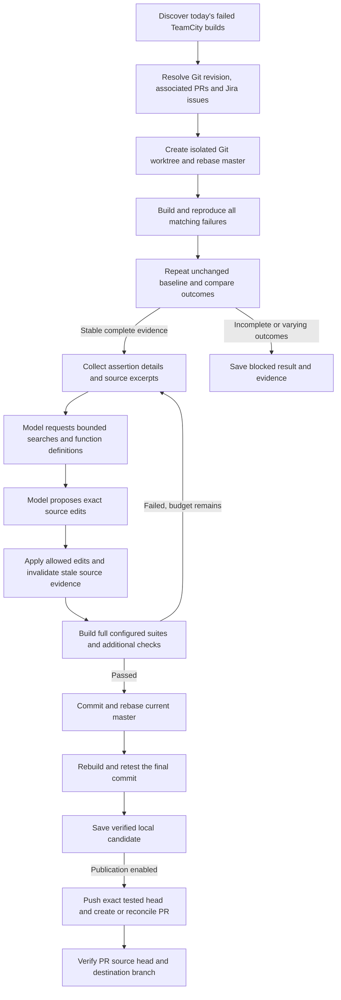

# How the workflow works

LangGraph owns the state transitions. Git, HTTP requests, compilers and test runners execute through ordinary Python adapters. The model investigates bounded source context and returns validated JSON proposals. A single worker processes failures sequentially; there is one configured model endpoint.

## From TeamCity to a reproducible failure

The CLI selects builds using the configured timezone and build configuration IDs. Each failure carries its TeamCity revision, test names, change list and evidence URLs. A stable identifier deduplicates repeated discovery. The worker collects commit-associated Bitbucket PRs and Jira keys before preparing an isolated worktree at the recorded revision.

The initial rebase checks whether the reported failure still exists on current master. Configure complete native suites and map TeamCity names to their exact XML identities. A missing or renamed test, a malformed report, an all-skipped report, an incomplete timed-out command or a failure that no longer reproduces stops the run before inference.

Set `baseline_repetitions: 2` for two unchanged-source builds and test runs. The passed, failed and skipped identity sets must agree, every original TeamCity failure must recur, and tracked sources and HEAD must remain unchanged. This catches observed instability; two observations do not establish that a test can never flake. The compatibility default remains one repetition.

## Investigation and repair

Structured diagnostics retain original failing identities while sampling model-facing details to fit the context budget. Fresh JUnit assertion text and compiler feedback help the next attempt. Expected/actual fields use explicit native labels; GoogleTest operand values remain attached to their named expressions in the assertion text, because operand order alone does not establish their roles. Source retrieval uses local includes, failure locations, symbols and prior proposals. An optional C++ parser supplies complete bounded function definitions, including templates and operators; ambiguous or oversized reads carry explicit uncertainty.

The model can request allowlisted searches and reads. A total inspection budget and an optional per-attempt limit reserve investigation capacity for later repair attempts. After an edit, the workflow discards cached evidence for every modified path. Distinct unchanged reads remain available within the evidence budget.

Proposals contain exact old/new text replacements. Path restrictions, exact anchors, edit-size limits and protected files are checked before application. The model has no shell access through this interface. Each attempt runs the configured native build and full suites; additional operator-owned checks can cover contracts absent from upstream tests.

## Validation and publication

A successful candidate must retain and pass every originally executed baseline identity, including tests that were already passing. The workflow commits the candidate, fetches master again, rebases and repeats verification on the final source. A conflict or regression stops publication.

These gates establish the configured native checks. They cannot establish behavior absent from those checks: independent evaluation review found Unicode width regressions in patches whose existing suites passed. That source and contract review is part of the evaluation procedure; the production graph does not contain an automatic semantic-review agent. A published PR remains a candidate for code review. Add relevant operator-owned suites through `build.additional_tests` when a missed contract matters for your solution.

Publication uses the exact tested commit. Saved intent and receipts support reconciliation when a push or PR response is lost. A PR response must identify the expected source branch, source commit and destination branch. An uncertain external result is recorded as `publication_unknown` for reconciliation. The worker never merges the PR.

The PR includes the explanation, original revision, final verified commit, test identities, TeamCity build, related PRs, Jira links and configured existing artifact URLs. New UI screenshot capture is an extension point; the current implementation links screenshots already stored in TeamCity.

## Evidence to inspect

Each run directory under `state_dir/runs` contains context, events, final state, baseline checks and native validation evidence. `checkpoints.sqlite` holds the LangGraph state after every super-step. `model-calls/` records each model request with its context, response, latency, usage and error. Model evaluations additionally retain exact requests, responses, CLI events, usage, diffs, source snapshots and publication receipts. Keep this directory on company-managed storage because it contains source and issue context.

`auto-fix dashboard` reconstructs every run from these files, read-only: the executed graph path, per-node state changes, complete checkpoint state, model calls and artifacts. Runs written before the dashboard existed are included; they lack only the `model-calls/` records.

| Concern | Implementation |
| --- | --- |
| Discovery, deduplication and process lock | `src/auto_fix/cli.py` |
| TeamCity, Bitbucket and Jira requests | `src/auto_fix/integrations.py` |
| Graph, attempt lifecycle and publication gates | `src/auto_fix/workflow.py` |
| Git isolation, context and exact edits | `src/auto_fix/workspace.py` |
| Structured failures and fresh assertions | `src/auto_fix/diagnostics.py`, `validation_context.py` |
| Model-directed reads and evidence invalidation | `src/auto_fix/investigation.py` |
| C++ definition retrieval | `src/auto_fix/cpp_symbols.py` |
| Native execution and report validity | `src/auto_fix/build.py` |
| PR receipt checks | `src/auto_fix/publication.py` |
| Endpoint prompts and validated responses | `src/auto_fix/llm.py`, `prompts.py` |
| Run history dashboard | `src/auto_fix/history.py`, `dashboard.py`, `dashboard.html` |
| Optional Phoenix OpenTelemetry export | `src/auto_fix/tracing.py` |

## Change the graph and measure the result

Add a named function to `Workflow`, register the node in `graph()` and connect its incoming and outgoing edges. State records carry the evidence another node needs. Deterministic steps such as ownership lookup, crash-dump parsing or an extra test selection do not require another model call. Use a conditional edge when a result should block or redirect a run.

For a model-facing change, freeze a development plan with the same case mutations and native oracle, run it in a separate output directory, then compare completed repairs, actual model calls, tokens and failure stages. Inspect successful patches independently: a green suite can miss a semantic regression. Keep failed attempts and compare the entire arm rather than choosing successful examples.

Select parameters on development cases, freeze the chosen implementation and inputs, and only then run untouched holdout cases. Repeated trials measure variability on those same cases; report their unique-case denominator separately. Saved responses support zero-inference native replays on Windows and Linux, but replay success does not count as another live model evaluation. See [the evaluation procedure](expanded-evaluation.md) and [artifact format](evidence-artifacts.md).
